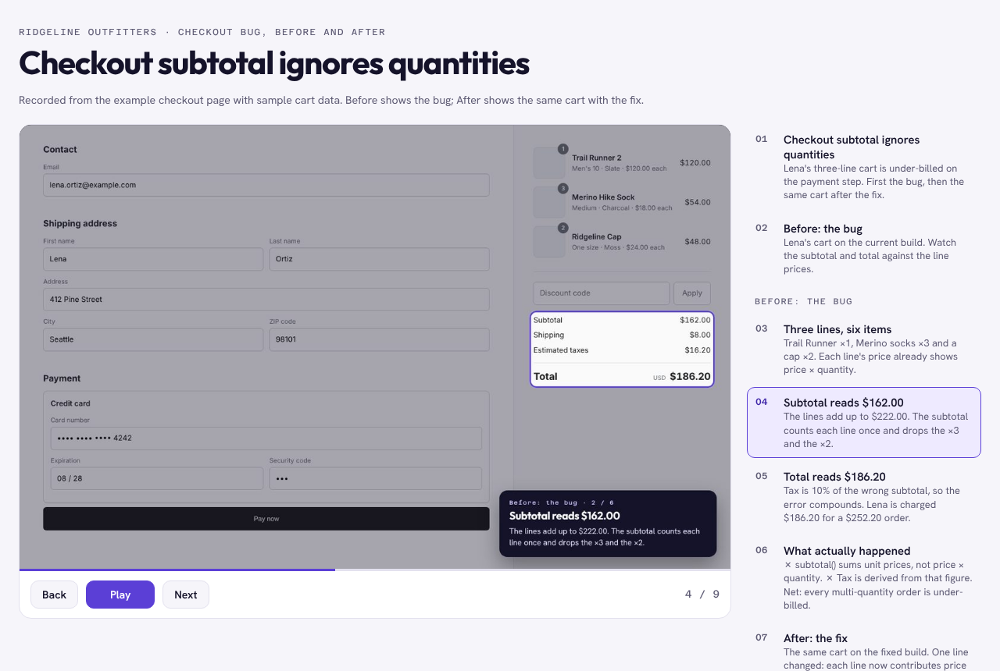
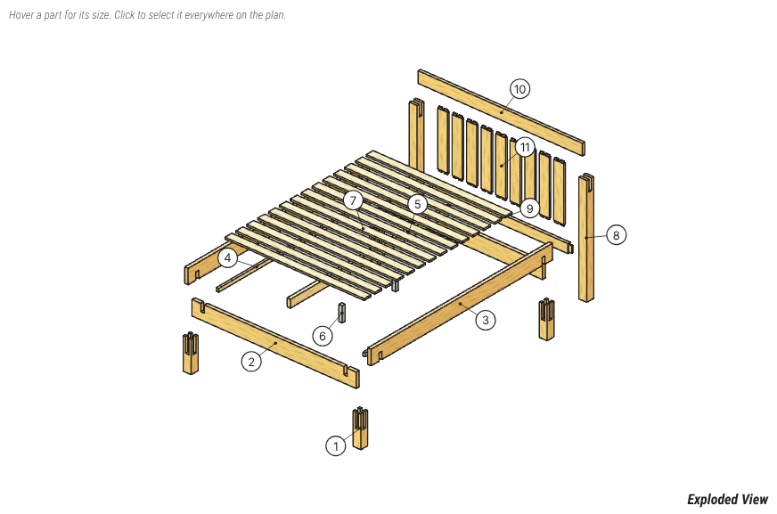

# skills

Public [Claude Code skills](https://docs.claude.com/en/docs/claude-code/skills) by [@seattlecyclist](https://github.com/seattlecyclist).
Each skill is a folder with a `SKILL.md`, and each has a section below with what it does, a demo and how to use it.

| Skill | What it does |
|---|---|
| [annotated-demo-video](#annotated-demo-video) | Record an annotated demo video of a feature or bug from the running app, as proof the work was verified. |
| [woodworking-plans](#woodworking-plans) | Design furniture and shop projects as magazine-style woodworking plans with a 3D exploded view, cut list and drawings, with every design checked for fit and joinery. |

## Install

Clone the repo and symlink (or copy) the skills you want into `~/.claude/skills/` for all projects, or
`.claude/skills/` inside one project:

```bash
git clone https://github.com/seattlecyclist/skills ~/src/skills
mkdir -p ~/.claude/skills
ln -s ~/src/skills/annotated-demo-video ~/.claude/skills/annotated-demo-video
ln -s ~/src/skills/woodworking-plans ~/.claude/skills/woodworking-plans
```

Claude Code picks the skill up on the next session. Invoke it with its slash command, or just describe
the task and it triggers on its own.

---

## annotated-demo-video

Drives a real running web app with Playwright, annotates each step, and produces a demo video. The
output is a before-and-after style walkthrough: a title card, one frame per step with the element that
matters ringed and captioned, and a closing frame on the outcome. Captions read values straight off the
page, so the agent cannot narrate a number it did not see.

Use it to prove a feature works, to reproduce a bug, or to attach a demo to a PR as evidence the change
was verified against the running app, not just described.

**What you get**

- An MP4 with crossfades, each frame held for its reading time.
- A self-contained HTML player with a step rail, chapters, keyboard controls and dark mode.
- A contact sheet of every frame. The agent reads this to verify the recording before showing anyone.

**Why it is a guardrail**

- Deterministic. The same storyboard against the same app state gives the same frames, so a re-record
  after a fix is a real diff.
- The contact sheet is the review step. The agent checks every frame before reporting done.
- Recording runs in a subagent, so the main agent keeps its context for the actual work.
- Making the video finds bugs. Pointing at the exact element and reading its value surfaces mistakes
  that a description would hide.

### Demo

A Shopify-style checkout with a planted bug: the subtotal sums unit prices and ignores line
quantities, so a $252.20 order is billed at $186.20. The video opens with a "Before: the bug" card,
drives the buggy page and rings the wrong values, then an "After: the fix" card introduces the same
frames against the fixed page. Every caption carries the chapter name.


https://github.com/user-attachments/assets/68274163-33cb-4c1b-8b47-ae092297337d


[](annotated-demo-video/examples/checkout/output/checkout-bug.mp4)


- 🎬 Video: [checkout-bug.mp4](annotated-demo-video/examples/checkout/output/checkout-bug.mp4)
- 🌐 HTML player: [checkout-bug.html](annotated-demo-video/examples/checkout/output/checkout-bug.html) (download and open)
- 🖼 Contact sheet: [sheet.png](annotated-demo-video/examples/checkout/output/sheet.png)

The pages, storyboard and run script are in
[annotated-demo-video/examples/checkout/](annotated-demo-video/examples/checkout/). The whole difference
between the buggy and fixed page is one line:

```js
// before
return items.reduce((sum, item) => sum + item.price, 0);
// after
return items.reduce((sum, item) => sum + item.price * item.qty, 0);
```

### Usage

**Prerequisites** (once per machine): Node 18+ with Playwright and Chromium, Python 3 with Pillow, and
ffmpeg for the MP4. Claude Code cloud containers have all of them.

```bash
mkdir -p /tmp/demos && cd /tmp/demos
npm i playwright && npx playwright install chromium
pip install pillow
```

**Self-test** the environment:

```bash
export WT=~/.claude/skills/annotated-demo-video
bash $WT/examples/run_example.sh /tmp/wt-example             # 5-step showcase on a tiny task board
bash $WT/examples/checkout/run_checkout.sh /tmp/wt-checkout  # the before/after bug demo above (9 frames)
```

**Ask Claude** for a walkthrough of a running app, giving it the flow in prose or as steps:

> Make an annotated demo video of the checkout at http://localhost:3000: show the cart, the
> subtotal, and the total, then the same cart after the fix on http://localhost:3001.

Claude writes a storyboard, records it, reads the contact sheet to verify every frame, builds the
outputs and ends with their absolute paths.

**Or drive it by hand.** Write a storyboard JSON (format in
[SKILL.md](annotated-demo-video/SKILL.md#storyboard-reference)), then:

```bash
node $WT/scripts/record.cjs storyboard.json --out /tmp/demos/my-demo
python3 $WT/scripts/finish.py /tmp/demos/my-demo --name my-demo
```

For Rails apps whose flows need fixtures or sign-in helpers, the Capybara adapter produces the same
frames from inside a system test.

Full workflow, storyboard reference, theming and pitfalls: [annotated-demo-video/SKILL.md](annotated-demo-video/SKILL.md).

---

## woodworking-plans

Turns a project idea into a plan a woodworker can build from, in the look of a classic woodworking
magazine's drawings supplement: white letter pages, peach-filled line drawings, a green material list
box, a blue hardware box and red only for identifying marks. It adds what paper can't do: a three.js
exploded view you can turn, explode, step through and isolate parts in, pan and zoom drawings, an
inch/mm toggle and a printable letter-size PDF built in the browser.

The model is the plan. Claude writes a parametric `plan.js` (parts, joints, bores, hardware), and the
page renders from it, so a change like "make it 6 inches wider" flows through every drawing, list and
cutting diagram.

**What you get**

- A numbered exploded view, material and hardware lists, a shopping list and a shop cut list sorted
  for the saw.
- Dimensioned part layouts, section views, joinery details and cutting diagrams with cut order.
- Jigs, full-size patterns and story sticks tiled at 100% in the PDF, build steps with "Show in 3D",
  and a finishing schedule.
- A Drawer Breakout for any plan with drawers: each opening with its slide (maker, model, length,
  clearances, mounting line), the box sized from the slide maker's spec sheet, the front's reveals or
  overlay and the pull. `references/drawers.md` holds the slide catalogue and formulas, with sources.

**Why it is a guardrail**

- A geometric model check runs on every build: interference, joint contact, tenon seating,
  connectivity, wood movement and bores, before anything is drawn.
- Drawer boxes are measured against their slide's spec: side clearance, undermount inside width,
  side thickness, bottom recess, box and slide length against the case depth.
- Every design and every later change gets an adversarial review that walks each change against the
  parts it touches and mates with, recorded on the plan's Revisions & Review sheet.
- `selftest.js` proves the checks still catch known breaks.

### Demo

A queen bed with castle-joint posts and a slatted headboard, the worked example in
[woodworking-plans/examples/castle-bed/](woodworking-plans/examples/castle-bed/):



- 🌐 Plan page: [castle-bed/plan.html](woodworking-plans/examples/castle-bed/plan.html) (download and open)
- 🗄 Casework example: [modern-dresser/plan.html](woodworking-plans/examples/modern-dresser/plan.html), an
  8-drawer plywood dresser with slides and full drawer boxes

### Usage

**Prerequisites:** Node 18+. The page loads three.js, html2canvas and jsPDF from jsDelivr. For
screenshots and the PDF test, `render_check.js` uses Playwright with Chromium.

**Self-test:**

```bash
export WP=~/.claude/skills/woodworking-plans
node $WP/scripts/selftest.js
```

**Ask Claude** for a plan:

> Draw me plans for a walnut side table, 24" tall, with mortise and tenon aprons and a drawer.

Claude asks once for anything that governs the design, writes `plan.js` from the skeleton, runs the
model check and the adversarial review, and publishes the page.

**Or drive it by hand:**

```bash
cp $WP/examples/skeleton/plan.js .
node $WP/scripts/build_plan.js plan.js --check     # model check only
node $WP/scripts/build_plan.js plan.js plan.html   # check and build the page
node $WP/scripts/render_check.js plan.js --pdf     # screenshots, PDF test, problem list
```

Full workflow, schema and review procedure: [woodworking-plans/SKILL.md](woodworking-plans/SKILL.md).
