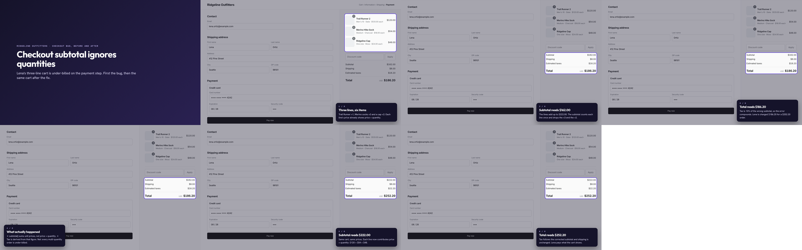

# skills

Public [Claude Code skills](https://docs.claude.com/en/docs/claude-code/skills) by [@seattlecyclist](https://github.com/seattlecyclist).

| Skill | What it does |
|---|---|
| [`annotated-demo-video`](annotated-demo-video/) | Drive a real web app with Playwright and produce a narrated, annotated walkthrough: an HTML player, an MP4 and a contact sheet, deterministically from a JSON storyboard. |

## Install

Skills are folders with a `SKILL.md`. Clone this repo and symlink (or copy) the ones you want into
`~/.claude/skills/` (user-wide) or `.claude/skills/` in a project:

```bash
git clone https://github.com/seattlecyclist/skills ~/src/skills
mkdir -p ~/.claude/skills
ln -s ~/src/skills/annotated-demo-video ~/.claude/skills/annotated-demo-video
```

Claude Code picks the skill up on the next session. Invoke it as `/annotated-demo-video`, or just ask
for a "demo video", "bug repro video" or "annotated walkthrough" and it triggers on its own.

## annotated-demo-video

### Demo: a checkout subtotal bug, before and after

The skill recorded itself against a Shopify-style checkout page with a planted bug: the subtotal sums
each line's unit price and ignores the quantity badges, so a $252.20 order is billed at $186.20. The
"Before" chapter drives the buggy page and rings the wrong values; the "After" chapter repeats the same
frames against the fixed page.

- 🎬 **MP4:** [`checkout-bug.mp4`](annotated-demo-video/examples/checkout/output/checkout-bug.mp4) (50 s)
- 🌐 **HTML player:** [`checkout-bug.html`](annotated-demo-video/examples/checkout/output/checkout-bug.html)
  (download and open; step rail, keyboard controls, light and dark mode)
- 🖼 **Contact sheet:** [`sheet.png`](annotated-demo-video/examples/checkout/output/sheet.png)



The pages, the storyboard and the script that produced it are in
[`annotated-demo-video/examples/checkout/`](annotated-demo-video/examples/checkout/). The whole
difference between `checkout.html` and `checkout-fixed.html` is one line:

```js
// before
return items.reduce((sum, item) => sum + item.price, 0);
// after
return items.reduce((sum, item) => sum + item.price * item.qty, 0);
```

### How to use it

1. **Prerequisites** (once per machine): Node 18+ with Playwright and Chromium, Python 3 with Pillow,
   and ffmpeg for the MP4. Claude Code cloud containers have all of them.

   ```bash
   mkdir -p /tmp/demos && cd /tmp/demos
   npm i playwright && npx playwright install chromium
   pip install pillow
   ```

2. **Self-test** the environment:

   ```bash
   export WT=~/.claude/skills/annotated-demo-video
   bash $WT/examples/run_example.sh /tmp/wt-example          # 5-step showcase on a tiny task board
   bash $WT/examples/checkout/run_checkout.sh /tmp/wt-checkout  # the before/after bug demo above
   ```

3. **Ask Claude for a walkthrough** of a running app, giving it the flow in prose or as steps:

   > Make an annotated demo video of the checkout at http://localhost:3000: show the cart, the
   > subtotal, and the total, then the same cart after the fix on http://localhost:3001.

   Claude writes a storyboard, records it, reads the contact sheet to verify every frame, builds the
   outputs and ends with their absolute paths.

4. **Or drive it by hand.** Write a storyboard JSON (format in
   [`SKILL.md`](annotated-demo-video/SKILL.md#storyboard-reference)), then:

   ```bash
   node $WT/scripts/record.cjs storyboard.json --out /tmp/demos/my-demo
   python3 $WT/scripts/finish.py /tmp/demos/my-demo --name my-demo
   ```

   Captions can read live values from the page with `{{ css selector }}`, so numbers are never
   hardcoded. For Rails apps whose flows need fixtures or sign-in helpers, the Capybara adapter
   produces the same frames from inside a system test.

See [`annotated-demo-video/SKILL.md`](annotated-demo-video/SKILL.md) for the full workflow, the
storyboard reference, theming and the pitfalls list.
