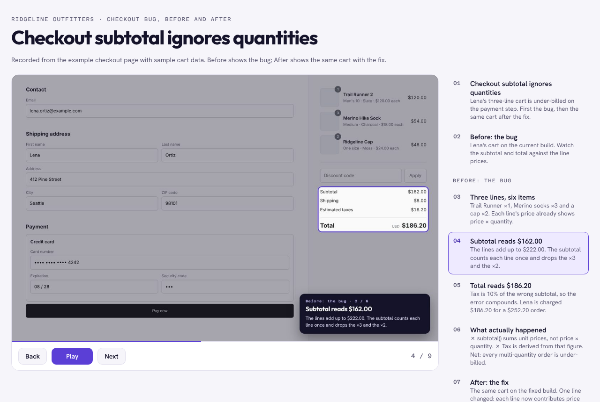
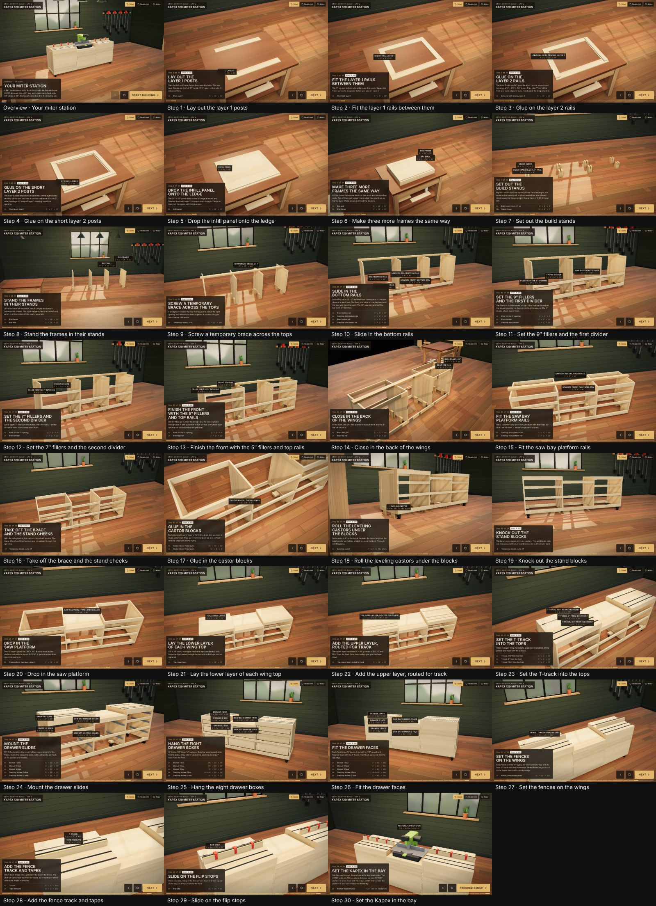
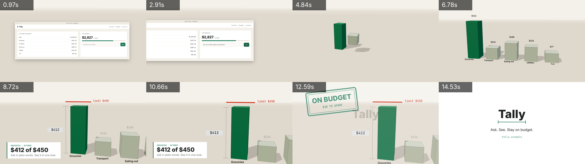
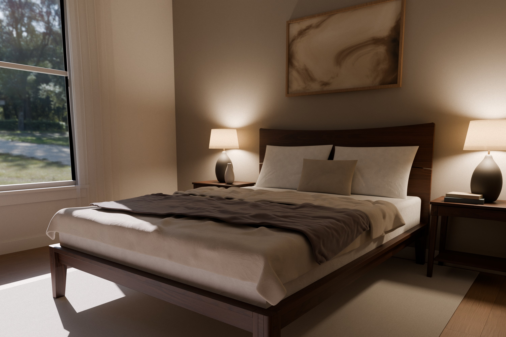
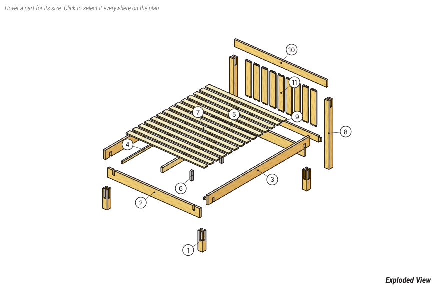

# skills

Public [Claude Code skills](https://docs.claude.com/en/docs/claude-code/skills) by [@seattlecyclist](https://github.com/seattlecyclist).
Each skill is a folder with a `SKILL.md`, and each has a section below with what it does, a demo and how to use it.

| Skill | What it does |
|---|---|
| [annotated-demo-video](#annotated-demo-video) | Record an annotated demo video of a feature or bug from the running app, as proof the work was verified. |
| [build-walkthrough-3d](#build-walkthrough-3d) | Turn a build plan into an interactive 3D step-by-step assembly walkthrough in a lit shop, with every move physics-checked. |
| [motion-video](#motion-video) | Make a short promo or explainer motion video for any product: real screens, 3D objects that assemble and get measured, captions, sound, voiceover, in 16:9 and 9:16. |
| [plan-to-photo](#plan-to-photo) | Turn a furniture plan and a description of a room into a photorealistic render of the piece in that room, built from the plan's exact geometry. |
| [woodworking-plans](#woodworking-plans) | Design furniture and shop projects as magazine-style woodworking plans with a 3D exploded view, cut list and drawings, with every design checked for fit and joinery. |

## Install

Clone the repo and symlink (or copy) the skills you want into `~/.claude/skills/` for all projects, or
`.claude/skills/` inside one project:

```bash
git clone https://github.com/seattlecyclist/skills ~/src/skills
mkdir -p ~/.claude/skills
ln -s ~/src/skills/annotated-demo-video ~/.claude/skills/annotated-demo-video
ln -s ~/src/skills/build-walkthrough-3d ~/.claude/skills/build-walkthrough-3d
ln -s ~/src/skills/motion-video ~/.claude/skills/motion-video
ln -s ~/src/skills/plan-to-photo ~/.claude/skills/plan-to-photo
ln -s ~/src/skills/woodworking-plans ~/.claude/skills/woodworking-plans
```

Claude Code picks the skill up on the next session. Invoke it with its slash command, or just describe
the task and it triggers on its own.

---

## annotated-demo-video

Drives a real running web app with Playwright, annotates each step, and produces a demo video. The
output is a before-and-after style walkthrough: a title card, one frame per step with the element that
matters ringed and captioned, and a closing frame on the outcome. Captions read values straight off the
page, so the agent cannot narrate a number it did not see.

Use it to prove a feature works, to reproduce a bug, or to attach a demo to a PR as evidence the change
was verified against the running app, not just described.

**What you get**

- An MP4 with crossfades, each frame held for its reading time.
- A self-contained HTML player with a step rail, chapters, keyboard controls and dark mode.
- A contact sheet of every frame. The agent reads this to verify the recording before showing anyone.

**Why it is a guardrail**

- Deterministic. The same storyboard against the same app state gives the same frames, so a re-record
  after a fix is a real diff.
- The contact sheet is the review step. The agent checks every frame before reporting done.
- Recording runs in a subagent, so the main agent keeps its context for the actual work.
- Making the video finds bugs. Pointing at the exact element and reading its value surfaces mistakes
  that a description would hide.

### Demo

A Shopify-style checkout with a planted bug: the subtotal sums unit prices and ignores line
quantities, so a $252.20 order is billed at $186.20. The video opens with a "Before: the bug" card,
drives the buggy page and rings the wrong values, then an "After: the fix" card introduces the same
frames against the fixed page. Every caption carries the chapter name.


https://github.com/user-attachments/assets/68274163-33cb-4c1b-8b47-ae092297337d


[](annotated-demo-video/examples/checkout/output/checkout-bug.mp4)


- 🎬 Video: [checkout-bug.mp4](annotated-demo-video/examples/checkout/output/checkout-bug.mp4)
- 🌐 HTML player: [checkout-bug.html](annotated-demo-video/examples/checkout/output/checkout-bug.html) (download and open)
- 🖼 Contact sheet: [sheet.png](annotated-demo-video/examples/checkout/output/sheet.png)

The pages, storyboard and run script are in
[annotated-demo-video/examples/checkout/](annotated-demo-video/examples/checkout/). The whole difference
between the buggy and fixed page is one line:

```js
// before
return items.reduce((sum, item) => sum + item.price, 0);
// after
return items.reduce((sum, item) => sum + item.price * item.qty, 0);
```

### Usage

**Prerequisites** (once per machine): Node 18+ with Playwright and Chromium, Python 3 with Pillow, and
ffmpeg for the MP4. Claude Code cloud containers have all of them.

```bash
mkdir -p /tmp/demos && cd /tmp/demos
npm i playwright && npx playwright install chromium
pip install pillow
```

**Self-test** the environment:

```bash
export WT=~/.claude/skills/annotated-demo-video
bash $WT/examples/run_example.sh /tmp/wt-example             # 5-step showcase on a tiny task board
bash $WT/examples/checkout/run_checkout.sh /tmp/wt-checkout  # the before/after bug demo above (9 frames)
```

**Ask Claude** for a walkthrough of a running app, giving it the flow in prose or as steps:

> Make an annotated demo video of the checkout at http://localhost:3000: show the cart, the
> subtotal, and the total, then the same cart after the fix on http://localhost:3001.

Claude writes a storyboard, records it, reads the contact sheet to verify every frame, builds the
outputs and ends with their absolute paths.

**Or drive it by hand.** Write a storyboard JSON (format in
[SKILL.md](annotated-demo-video/SKILL.md#storyboard-reference)), then:

```bash
node $WT/scripts/record.cjs storyboard.json --out /tmp/demos/my-demo
python3 $WT/scripts/finish.py /tmp/demos/my-demo --name my-demo
```

For Rails apps whose flows need fixtures or sign-in helpers, the Capybara adapter produces the same
frames from inside a system test.

Full workflow, storyboard reference, theming and pitfalls: [annotated-demo-video/SKILL.md](annotated-demo-video/SKILL.md).

---

## build-walkthrough-3d

Turns a woodworking or shop plan into the page you keep open in the shop: the piece in a lit 3D
workshop, one step at a time, each new part sliding or dropping into place, glowing, and labelled with
its name and size. Tap any part to measure it. Every step has its own link, so "you're on step 14"
is a URL. It pairs with [woodworking-plans](#woodworking-plans): that skill designs the piece, this one
shows how to put it together.

The model is the walkthrough. Claude writes one `build.js`: parts as boxes in their finished place,
grouped into rigid bodies (a glued-up frame moves as one), then steps that move bodies in along paths.

**What you get**

- A single HTML page: three.js scene with Baltic birch ply edges, solid woods, hardware, an assembly
  table, shop lights and a room sized to the piece; a step card with the parts each step adds and their
  sizes; progress bar, keyboard controls, phone layout.
- Sub-assemblies glued up flat on the table, then stood up; temporary fixtures (build stands, braces)
  that go on and come off again.
- A contact sheet of every step and a phone screenshot, which Claude reads before showing you.

**Why it is a guardrail**

- A physics check runs on every build: each move is sampled along its path and no part may pass
  through another, the floor, the table or a light; at the end of each step every part must touch
  something and every loose part must sit on something; the finished piece may have no overlaps.
- `mutate.js` breaks moves in the build on purpose (a part pushed ¼″ into its neighbour, a top lifted
  ⅛″) and fails unless the check catches every one.
- The page re-runs the check in the viewer's own browser and says so in its About panel.
- Writing the moves finds order problems a written plan hides: a rail that cannot get past a post, a
  block that cannot go in once the top is on.

### Demo

A Festool Kapex KS 120 miter station: 272 parts, 30 steps, from cross-frames glued up flat to the saw
dropping into its bay, in [build-walkthrough-3d/examples/miter-station/](build-walkthrough-3d/examples/miter-station/):

[](build-walkthrough-3d/examples/miter-station/walkthrough.html)

- 🌐 Walkthrough: [walkthrough.html](build-walkthrough-3d/examples/miter-station/walkthrough.html) (download and open)
- 🧱 Model and sequence: [build.js](build-walkthrough-3d/examples/miter-station/build.js)
- 📚 Starter: [skeleton/build.js](build-walkthrough-3d/examples/skeleton/build.js), a 6-step plywood bookcase

### Usage

**Prerequisites:** Node 18+. `render_check.js` uses Playwright with Chromium. The page loads three.js
0.160.0 from jsDelivr; offline, `npm i three@0.160.0` and pass `--libs node_modules`.

**Self-test:**

```bash
export BW=~/.claude/skills/build-walkthrough-3d
node $BW/scripts/verify.js $BW/examples/miter-station/build.js
node $BW/scripts/mutate.js $BW/examples/miter-station/build.js
```

**Ask Claude** for a walkthrough, with the plan attached or already in the conversation:

> Make a 3D step-by-step build guide for this miter station plan, so I can follow it in the shop.

> Show me how to assemble the bookcase from my woodworking plan, one step at a time.

> Animate the assembly of this workbench: frames first, then rails, then the top.

> What order should I glue this cabinet up in? Show it in 3D.

> The fence goes on before the T-track in my shop, swap those steps.

Claude copies sizes from the plan, writes the sequence the way you would work, proves it, looks at
every step, and publishes the page.

**Or drive it by hand:**

```bash
cp $BW/examples/skeleton/build.js .
node $BW/scripts/verify.js build.js                       # physics check
node $BW/scripts/mutate.js build.js                       # the check catches broken moves
node $BW/scripts/render_check.js build.js --out check     # every step, contact sheet, phone view
node $BW/scripts/build.js build.js walkthrough.html --standalone
```

Full workflow, API and sequencing rules: [build-walkthrough-3d/SKILL.md](build-walkthrough-3d/SKILL.md).

---

## motion-video

Makes a short promo, teaser or explainer film for whatever the user has: a product, an app, a feature,
an idea. The film is an HTML page whose picture is a pure function of time, `renderAt(t)`, rendered frame
by frame in headless Chrome and piped into ffmpeg. That makes every render identical, lets any moment be
checked as a still before the long render, and lines sound up with picture to the frame.

**What you get**

- 16:9 and 9:16 (and 1:1) MP4s from one scene, mixed to -14 LUFS and -2 dBTP.
- A scene kit (`kit.js`, three.js): eased shot lists, parts that fly in and land, dimension lines that
  draw themselves, a browser window showing a real screenshot with typing painted over it, captions, a
  rubber stamp and an end card.
- Sound synthesized from the picture's own events (key ticks, knocks as parts land, a stamp thud, a
  chime) over a music bed, each one frame after its event.
- A voiceover when a key is available: ElevenLabs or OpenAI TTS line by line, or one take (from an
  ElevenLabs connector or the user's own recording) split into lines at its pauses. With neither, the
  film is made with captions only.

**Why it is a guardrail**

- Contact sheets of chosen moments are the review step. The agent reads them, for both formats, before
  spending minutes on a full render and again before delivering.
- Real footage. Screens are captured from the running product, with element boxes, rather than mocked.
- Measured, not guessed: the scene animates over the captured boxes, and the loudness target is
  measured and reported.

### Demo

A 15 s teaser for a made-up budgeting app, "Tally", in
[motion-video/examples/budget-teaser/](motion-video/examples/budget-teaser/): the app with a question
typed in, the spending categories landing as bars, groceries measured against its limit, an ON BUDGET
stamp and an end card. Narrated by an ElevenLabs voice: one take, split into lines at its pauses, with
the beats timed to the words (the dimension label lands on "four hundred twelve dollars", the stamp on
"under budget").

[](motion-video/examples/budget-teaser/output/tally-h.mp4)

- 🎬 16:9: [tally-h.mp4](motion-video/examples/budget-teaser/output/tally-h.mp4)
- 📱 9:16: [tally-v.mp4](motion-video/examples/budget-teaser/output/tally-v.mp4)
- 🖼 Contact sheets: [16:9](motion-video/examples/budget-teaser/output/sheet.png), [9:16](motion-video/examples/budget-teaser/output/sheet-v.png)

### Usage

**Prerequisites:** Node 18+ with Playwright and Chromium, Python 3 and ffmpeg. Claude Code cloud
containers have all of them. Scenes load three.js and fonts from CDNs. For a voiceover, set
`ELEVENLABS_API_KEY` or `OPENAI_API_KEY`.

**Self-test** (a quick 12 fps draft of the demo):

```bash
export MV=~/.claude/skills/motion-video
FPS=12 $MV/examples/budget-teaser/run.sh
```

**Ask Claude** for a film:

> Make a 20 second launch video for our app at https://app.example.com, 16:9 and vertical, with a
> voiceover. The idea: you ask a question and get a chart in one look.

Claude asks once for what it cannot find (colours, URL, the one idea), writes the script and beat sheet,
captures the real screens, builds the scene, checks contact sheets, renders, voices and mixes it.

**Or drive it by hand:**

```bash
mkdir film && cd film
cp $MV/assets/scene.template.html scene.html && cp $MV/assets/kit.js .
node $MV/scripts/stills.mjs scene.html --out stills --count 10
node $MV/scripts/render.mjs scene.html --fps 60 --out film.mp4
python3 $MV/scripts/voiceover.py tts lines.txt --out vo && python3 $MV/scripts/voiceover.py place timeline.json --duration 20 --out vo.wav
python3 $MV/scripts/mix.py film.mp4 --sfx film.sfx.wav --vo vo.wav --out final.mp4
```

Full workflow, beat sheet, principles, voiceover paths and pitfalls: [motion-video/SKILL.md](motion-video/SKILL.md).

---

## plan-to-photo

Takes a plan and a description of a setting (a bedroom, a kitchen, a living room) and makes a
photorealistic picture of the piece in that room. The plan's geometry is imported exactly, so the
joinery, tapers and proportions in the picture are the ones that will be built; AI image generators
redraw the piece and lose them, so this is done the archviz way, in Blender Cycles.

**What you get**

- A 3000x2000 render of the piece in a room built around it: walls, a window with trim and sheer
  curtains, a plank floor, a rug, lamps, books, art.
- Scanned CC0 materials from Poly Haven and ambientCG, with the wood grain running along every part
  and a finish applied (oiled walnut is darker and warmer than a raw scan).
- Soft goods from cloth simulation: a duvet folded back, creased pillows that lean on the headboard
  and dent the mattress, a throw.
- An HDRI sky with its sun cut out and replaced by a matched sun lamp, window portals, AgX tone
  mapping, depth of field.
- A review sheet: the frame plus 100% crops where renders give themselves away.

**Why it is a guardrail**

- Exact geometry. It renders the plan you will build, not a picture that looks like it.
- Every rule in `references/realism.md` comes from a real miss on the example bed: floating pillows,
  slat-shaped light leaks under the bed, procedural wood, blotchy walls, a blown sun patch, a window
  view that looked pasted in.
- Builds print checks (pillow to headboard, pillow to mattress, mattress dent, model bbox) and the
  review sheet is read before a final render is spent.
- Versioned: one change per version, same camera, so versions compare side by side.

### Demo

The queen walnut castle-leg bed from its Rev A plan, in a bedroom with matching walnut nightstands
(render v6):



- 📐 The plan it was made from: [plan.js](plan-to-photo/examples/walnut-bed/plan.js) and the shop plan
  page [plan.html](plan-to-photo/examples/walnut-bed/plan.html) (download and open)
- 🧾 Scene: [scene.json](plan-to-photo/examples/walnut-bed/scene.json) and
  [walnut_bed.py](plan-to-photo/examples/walnut-bed/walnut_bed.py) (rebuilt legs and curved headboard,
  the nightstands)
- 📜 How it got there, v1 to v6: [original/](plan-to-photo/examples/walnut-bed/original/)

### Usage

**Prerequisites:** Blender 4.2+ (`blender` on PATH, or `pip install bpy`), Node 18+ for plan.js
export, Python 3 with Pillow. A GPU for the final: about 15 minutes at 3000x2000 on an Apple M2 Max,
hours on a CPU. Network access to polyhaven.com and ambientcg.com for the scans.

**Self-test** (exports the plan, fetches the scans, builds, renders a quarter-size preview):

```bash
export P2P=~/.claude/skills/plan-to-photo
$P2P/examples/walnut-bed/run.sh /tmp/walnut-bed --preview
```

**Ask Claude** for a render. Some prompts that work:

> Render my bed plan (plan.js) in a calm Scandinavian bedroom: white oak floor, linen bedding in
> oatmeal, morning light from a window on the left. Photorealistic, 3:2.

> Put this walnut sideboard in a mid-century living room with a dark green wall, a wool rug and late
> afternoon sun. Shoot it straight on at eye height.

> Here is my kitchen island model (island.glb). Show it in a bright kitchen with a white quartz
> counter, brass pulls, two pendant lights and a bowl of lemons.

> Make a catalogue shot of the round dining table from my woodworking plan, with four chairs pulled
> out, a linen runner and an overcast window behind it.

> Same scene, but make the throw mauve and swap the oak nightstands for walnut ones that match the
> bed. Keep the camera.

> The pillows look like they're floating and there are stripes in the shadow under the bed. Fix
> them and render v4.

Claude reads the plan, picks a room recipe and says what it chose, fetches the scans, builds the
scene, previews and reviews it, then renders the final and iterates by version.

**Or drive it by hand:**

```bash
node $P2P/scripts/export_obj.js plan.js bed.obj
python3 $P2P/scripts/fetch_assets.py assets $(python3 $P2P/scripts/fetch_assets.py assets --list bedroom)
blender -b -P $P2P/scripts/build_scene.py -- scene.json
blender -b -P $P2P/scripts/render.py -- scene.blend v1.png --hdri assets/hdri/borghese_gardens_4k.exr \
  --cam 2.45,-1.1,0.95 --target 0.6,1.3,0.5 --sun-az 160 --res 3000x2000 --samples 2048
python3 $P2P/scripts/review.py v1.png
```

Full workflow, scene spec, room recipes and realism rules: [plan-to-photo/SKILL.md](plan-to-photo/SKILL.md).

---

## woodworking-plans

Turns a project idea into a plan a woodworker can build from, in the look of a classic woodworking
magazine's drawings supplement: white letter pages, peach-filled line drawings, a green material list
box, a blue hardware box and red only for identifying marks. It adds what paper can't do: a three.js
exploded view you can turn, explode, step through and isolate parts in, pan and zoom drawings, an
inch/mm toggle and a printable letter-size PDF built in the browser.

The model is the plan. Claude writes a parametric `plan.js` (parts, joints, bores, hardware), and the
page renders from it, so a change like "make it 6 inches wider" flows through every drawing, list and
cutting diagram.

**What you get**

- A numbered exploded view, material and hardware lists, a shopping list and a shop cut list sorted
  for the saw.
- Dimensioned part layouts, section views, joinery details and cutting diagrams with cut order.
- Jigs, full-size patterns and story sticks tiled at 100% in the PDF, build steps with "Show in 3D",
  and a finishing schedule.
- A Drawer Breakout for any plan with drawers: each opening with its slide (maker, model, length,
  clearances, mounting line), the box sized from the slide maker's spec sheet, the front's reveals or
  overlay and the pull. `references/drawers.md` holds the slide catalogue and formulas, with sources.
- A Door Breakout for any plan with doors: each opening with its doors sized from the case and the
  style's reveals, the hinge (maker, model, count and positions), the cup bore distance and plate
  worked from the hinge maker's overlay formula, the swing clearance and the pull.
  `references/doors.md` holds the hinge catalogue (Blum, Salice, Grass, Hettich), reveal rules and
  door construction, with sources.

**Why it is a guardrail**

- A geometric model check runs on every build: interference, joint contact, tenon seating,
  connectivity, wood movement and bores, before anything is drawn.
- Drawer boxes are measured against their slide's spec: side clearance, undermount inside width,
  side thickness, bottom recess, box and slide length against the case depth.
- Doors are measured against their hinge's sheet: the overlay its cup distance and plate give, the
  minimum reveal at the hinge edge, hinge count for the door's height and weight, the cup bore.
- Every design and every later change gets an adversarial review that walks each change against the
  parts it touches and mates with, recorded on the plan's Revisions & Review sheet.
- `selftest.js` proves the checks still catch known breaks.

### Demo

A queen bed with castle-joint posts and a slatted headboard, the worked example in
[woodworking-plans/examples/castle-bed/](woodworking-plans/examples/castle-bed/):



- 🌐 Plan page: [castle-bed/plan.html](woodworking-plans/examples/castle-bed/plan.html) (download and open)
- 🗄 Casework example: [modern-dresser/plan.html](woodworking-plans/examples/modern-dresser/plan.html), an
  8-drawer plywood dresser with slides and full drawer boxes

### Usage

**Prerequisites:** Node 18+. The page loads three.js, html2canvas and jsPDF from jsDelivr. For
screenshots and the PDF test, `render_check.js` uses Playwright with Chromium.

**Self-test:**

```bash
export WP=~/.claude/skills/woodworking-plans
node $WP/scripts/selftest.js
```

**Ask Claude** for a plan:

> Draw me plans for a walnut side table, 24" tall, with mortise and tenon aprons and a drawer.

Claude asks once for anything that governs the design, writes `plan.js` from the skeleton, runs the
model check and the adversarial review, and publishes the page.

**Or drive it by hand:**

```bash
cp $WP/examples/skeleton/plan.js .
node $WP/scripts/build_plan.js plan.js --check     # model check only
node $WP/scripts/build_plan.js plan.js plan.html   # check and build the page
node $WP/scripts/render_check.js plan.js --pdf     # screenshots, PDF test, problem list
```

Full workflow, schema and review procedure: [woodworking-plans/SKILL.md](woodworking-plans/SKILL.md).
